# 🚚 LaneRoom: an AI tender committee for freight lanes

[](https://github.com/balum211/LaneRoom/actions/workflows/ci.yml)


**Team 24 · The Gen Academy, Mastering Agentic AI · Demo Day 2026** · sibling of [DealRoom](https://github.com/balum211/DealRoom)

**▶ Live app: https://team24-logisticslanedealroom.streamlit.app** (offline agents, no key needed; first load after idle takes 1 to 2 minutes) ·
Submission: [proposal PDF](docs/Team24_LaneRoom_Proposal.pdf) · [form guide](docs/SUBMISSION.md)

LaneRoom is a team of AI agents that runs a shipper's **tender committee**. Give it a lane ("Dallas→Atlanta dry
van, 500 weekly loads") and it reads the carriers' SEC 10-K filings and the shipper's lane scorecard, has a **Cost**
advocate and a **Resilience** advocate argue how to split the loads, has a **Verifier** check every claim against the
page or scorecard row it cites, and hands a **human** a cited memo with a recommended **allocation % per carrier**.

Providers compared: **J.B. Hunt** (JBHT, asset carrier: intermodal and dedicated), **C.H. Robinson** (CHRW, non-asset
broker / 3PL), **Old Dominion Freight Line** (ODFL, LTL carrier), plus four privately held providers with synthetic
profiles: **Armada**, **Edge Logistics**, **First Star** and **BlueGrace Logistics** (see the data note).

> **What is real and what is synthetic**
> - **Real:** the FY2025 Form 10-K filings of J.B. Hunt, C.H. Robinson and Old Dominion, downloaded from SEC EDGAR.
>   Every financial figure LaneRoom shows for them is read from those filings and cited by page.
> - **Synthetic (private providers):** Armada, Edge Logistics (Edge Logistics LLC), First Star (First Star LLC) and
>   BlueGrace Logistics (BlueGrace Logistics LLC) are privately held and file nothing with the SEC. Each document is an
>   illustrative provider profile written for this demo. **None of it is data from, or a claim about, the real
>   companies with these names**, and none of the numbers are real. Each is labelled "SYNTHETIC" on every page,
>   flagged in the index, and capped at 25% of any lane.
> - **Badges, not logos:** each carrier is shown with an original monogram badge (mode icon + initials), not the
>   company's real logo or trademark.
> - **Synthetic (scorecard):** 10-Ks never report a shipper's tender acceptance, on-time %, rate per mile or claims %
>   by carrier, so the lane scorecard in `data/scorecard/` is synthetic demo data for **all seven** providers.
>   A real shipper would export the same columns from its TMS.

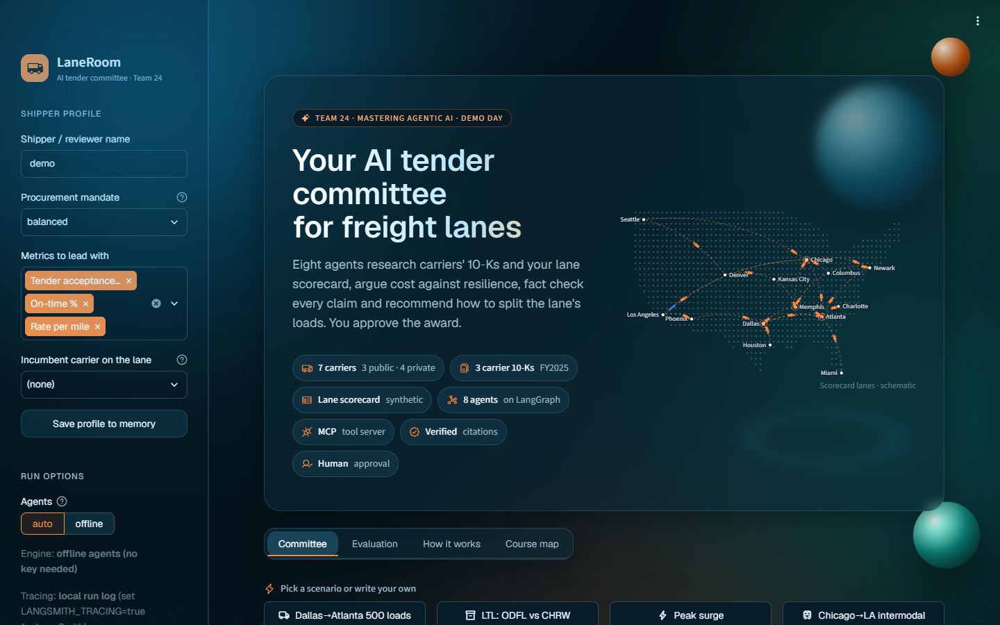

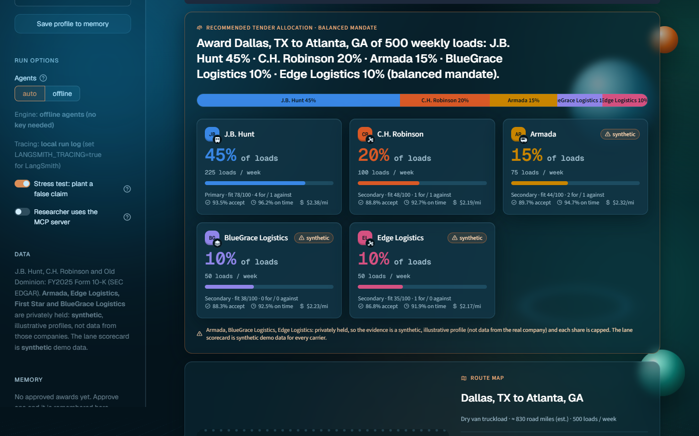

| Route map: one coloured route per carrier on a real map, width = share | Network map on real geography | Carrier roster with badges |
|---|---|---|
| 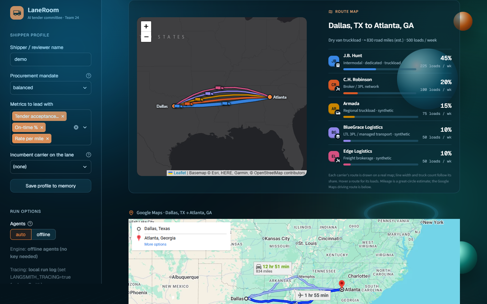 | 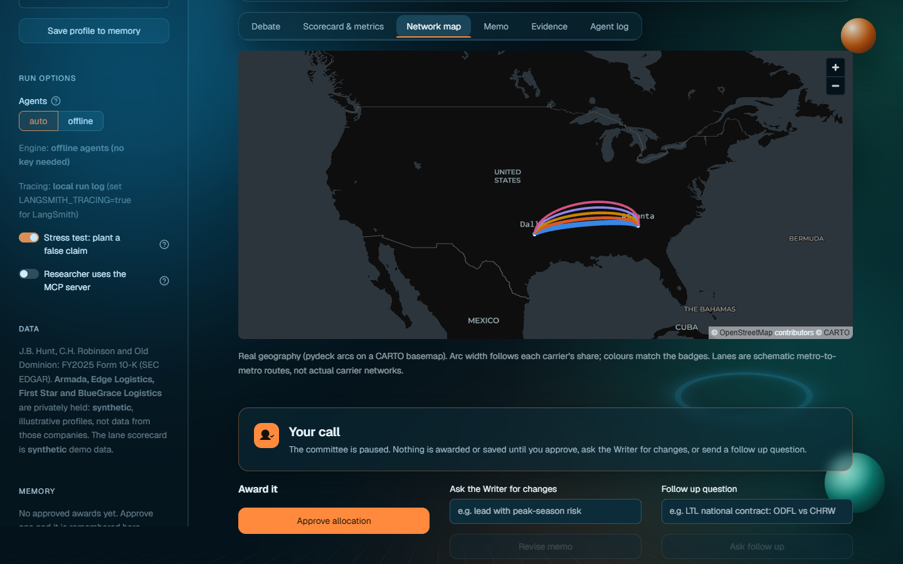 | 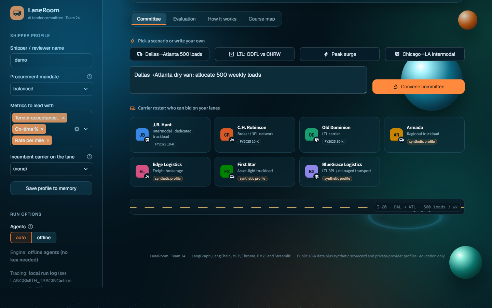 |

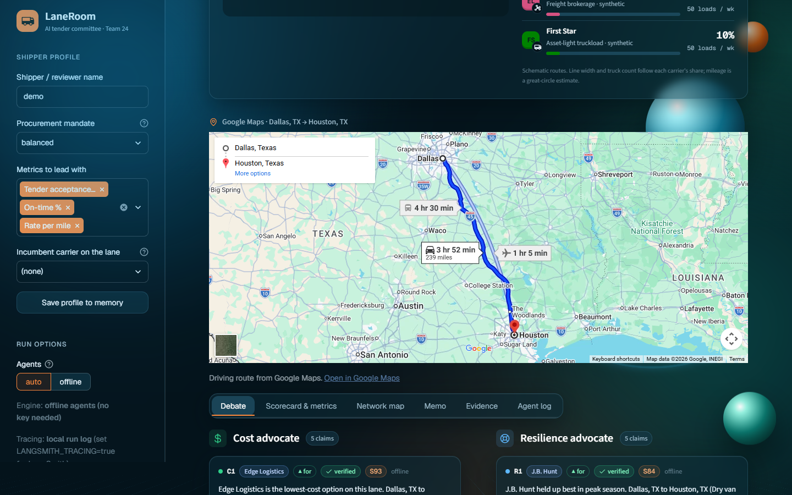

| Verifier catches a planted claim | Lane scorecard and 10-K financials | Cited tender memo |
|---|---|---|
| 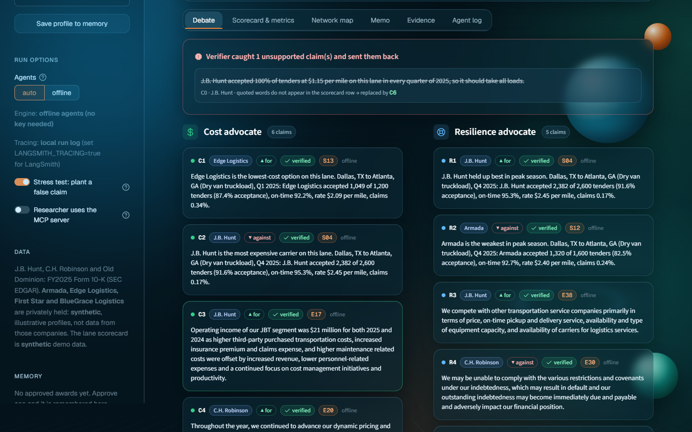 | 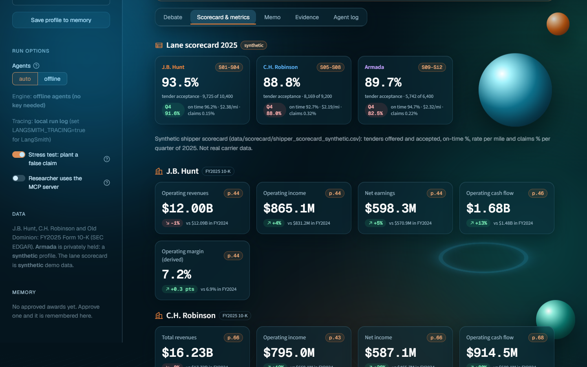 | 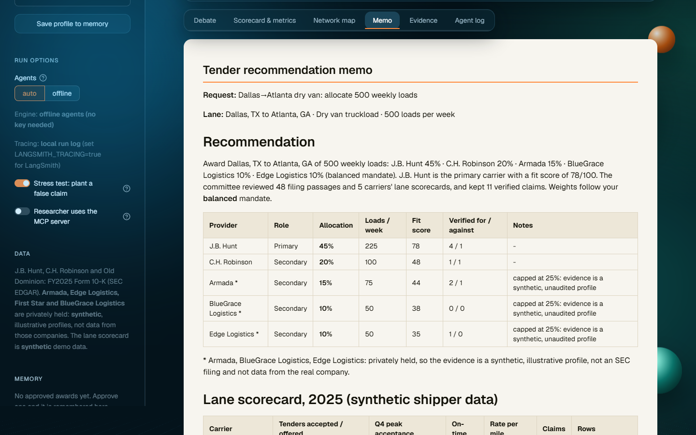 |

| Exact source text behind every citation | Agent log: time, LLM calls, tokens and cost | Approved award saved to memory |
|---|---|---|
| 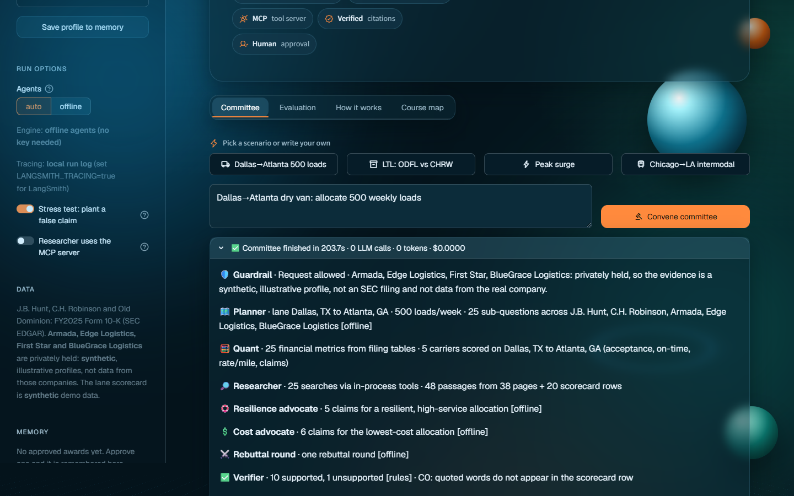 | 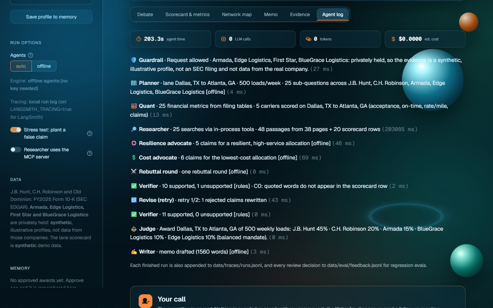 | 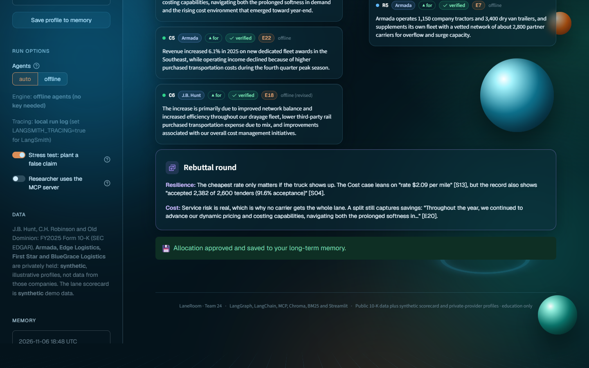 |

| Evaluation report | Course map: Weeks 1 to 5 in LaneRoom |
|---|---|
| 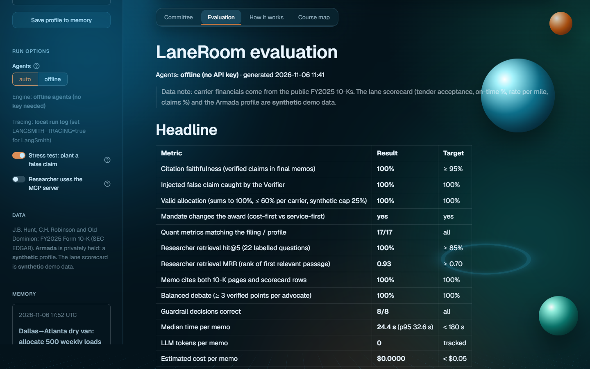 | 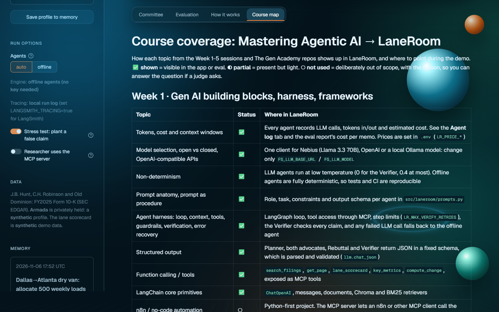 |

## Why it is agentic, not just RAG

| Capability | How LaneRoom does it |
|---|---|
| Planning | A Planner finds the lane, the providers and the weekly load count, then splits the request into capacity/reliability, cost, financial health, service fit and risk sub-questions per provider |
| Tool use + MCP | Researcher runs hybrid search over the 10-Ks and pulls the lane's scorecard rows; Quant reads figures straight from the filings' tables. The same tools are served by an **MCP server** |
| Multi-agent debate | A Cost advocate and a Resilience advocate run in parallel on the same evidence, then a rebuttal round |
| Self-correction | The Verifier rejects claims whose quote is not on the cited page / scorecard row or whose numbers are not in the source, and loops them back for a rewrite (max 2) |
| Decision | A Judge scores each carrier from lane KPIs, financial health and the verified debate, weighted by the shipper's mandate, then allocates 100% of loads under tender rules (≤ 60% per carrier, ≥ 10% backup share, 80% acceptance floor, 25% cap on synthetic-only evidence) |
| Human in the loop | LangGraph `interrupt()` pauses before anything is awarded: approve, request changes, or ask a follow-up |
| Memory | Thread memory in the LangGraph checkpointer; long-term shipper memory (cost-first / balanced / service-first mandate, preferred KPIs, incumbent carrier, past awards) that changes the Judge's weighting |
| Logistics UI | Animated US route map with moving trucks (and a train on the intermodal lane), a per-lane route card that draws each carrier's route on a real map (Leaflet, Esri dark basemap, no key) with moving trucks and width following its share, a **Google Maps** driving route for the lane (official Embed API with `GOOGLE_MAPS_API_KEY`, keyless embed otherwise), a pydeck arc map on real geography, carrier badges and a carrier roster |
| Guardrails | Prompt-injection, scope and unknown-carrier checks on input, injection stripping on retrieved text, no stock advice in output, synthetic data labelled everywhere, disclaimer always added |

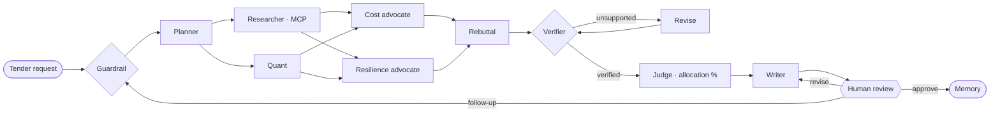

More detail: [docs/ARCHITECTURE.md](docs/ARCHITECTURE.md) · Proposal: [docs/PROPOSAL.md](docs/PROPOSAL.md) ·
Demo script: [docs/DEMO_SCRIPT.md](docs/DEMO_SCRIPT.md) · Course topics covered: [docs/COURSE_COVERAGE.md](docs/COURSE_COVERAGE.md)

## Scenarios

| Scenario | Lane in the scorecard | Example award (balanced mandate, offline agents) |
|---|---|---|
| **Dallas→Atlanta dry van: allocate 500 weekly loads** | DAL-ATL · J.B. Hunt, C.H. Robinson, Armada, Edge Logistics, BlueGrace Logistics | J.B. Hunt 45% (225 loads) · C.H. Robinson 20% · Armada 15% · BlueGrace Logistics 10% · Edge Logistics 10% |
| **LTL national contract: ODFL vs CHRW** | LTL-NAT · Old Dominion, C.H. Robinson, Armada, BlueGrace Logistics, First Star | Old Dominion 60% · C.H. Robinson 40% (the two named carriers) |
| **Peak season surge capacity** | PEAK-NAT · six carriers | J.B. Hunt 35% · Old Dominion 30% · C.H. Robinson 15% · Edge Logistics 10% · Armada 10% |
| *Typed:* **Dallas→Houston dry van: allocate 500 weekly loads** | DAL-HOU · J.B. Hunt, C.H. Robinson, Armada, Edge Logistics, First Star | J.B. Hunt 40% · Armada 25% · C.H. Robinson 15% · Edge Logistics 10% · First Star 10% |
| **Chicago→LA intermodal: 300 weekly loads** | CHI-LAX · J.B. Hunt, C.H. Robinson, Edge Logistics, First Star | J.B. Hunt 60% · C.H. Robinson 15% · Edge Logistics 15% · First Star 10% |

The scorecard covers eight lanes: Dallas→Atlanta, Dallas→Houston, Atlanta→Miami, Los Angeles→Phoenix, Chicago→Newark, Chicago→Los Angeles intermodal, a national LTL contract and peak-season surge. The Planner matches the two cities in a typed request to a lane; if a
city pair is not on file, the app says which lane it used instead of switching silently.

Switch the mandate and the award moves: for peak season, **cost-first** gives Old Dominion 15%, while
**service-first** gives it 40%. These awards come from synthetic scorecard data and illustrate the
method only.

## Results

Offline agents, no API key ([eval/results/summary.md](eval/results/summary.md)):

| Metric | Result | Target |
|---|---|---|
| Citation faithfulness (verified claims in final memos) | **100%** | ≥ 95% |
| Injected false claim caught by the Verifier | **100%** | 100% |
| Valid allocation (≤ 100%, ≤ 60% per carrier, synthetic cap 25%) | **100%** | 100% |
| Mandate changes the award (cost-first vs service-first) | **yes** | yes |
| Quant metrics matching the printed filing / profile | **29/29** | all |
| Researcher retrieval hit@5 (25 labelled questions) | **100%** | ≥ 85% |
| Researcher retrieval MRR | **0.94** | ≥ 0.70 |
| Memo cites both 10-K pages and scorecard rows | **100%** | 100% |
| Guardrail decisions correct | **8/8** | all |
| Median time per memo | **~29 s** on a laptop CPU | < 180 s |
| Estimated cost per memo (offline agents) | **$0** · tokens and cost are tracked per agent in LLM mode | < $0.05 |

**Plain RAG vs LaneRoom:** plain RAG never produces an allocation and
cites 4.8 sources per answer; LaneRoom allocates in 100% of runs, weighs cost and service evidence in 100%, cites
9.5 sources and checks every claim. Each committee run includes a planted false claim ("J.B. Hunt accepted 100% of
tenders at $1.15 per mile…") so the Verifier → revise loop is exercised every time. Offline advocates quote their
evidence exactly, so faithfulness is high by design; with an API key run `python eval/run_eval.py --mode auto` to
measure the LLM-written claims the same way.

## Quick start

```bash
# Windows: double-click run.bat
# macOS / Linux:
./run.sh
# or manually:
python -m venv .venv && source .venv/bin/activate      # Windows: .venv\Scripts\activate
pip install -r requirements.txt
cp .env.example .env                                    # optional: add NEBIUS_API_KEY or OPENAI_API_KEY
streamlit run app.py
```

- **No API key needed.** Without a key, deterministic offline agents run the full graph (extractive claims,
  rule-based verification, scored allocation, template memo). With `NEBIUS_API_KEY` or `OPENAI_API_KEY` set, the
  Planner, both advocates, Rebuttal, Verifier judge and Writer become LLM calls, and any LLM failure falls back to
  the offline agent.
- First start downloads the 80 MB MiniLM ONNX embedding model once. The search index is committed in
  `data/processed/`, so the app is ready in seconds after that.

### Try it
1. Click **Dallas→Atlanta 500 loads** and **Convene committee**.
2. Turn on **Stress test: plant a false claim** in the sidebar to watch the Verifier reject it.
3. Pick **Peak surge**, switch the mandate from **balanced** to **service-first** or **cost-first**, and run again.
4. **Approve allocation**, then see it under **Memory** in the sidebar.

### MCP server
```bash
python -m laneroom.mcp_server                                # run from src/, or set PYTHONPATH=src
npx @modelcontextprotocol/inspector python -m laneroom.mcp_server
```
Claude Desktop (`claude_desktop_config.json`):
```json
{"mcpServers": {"laneroom-carriers": {"command": "python", "args": ["-m", "laneroom.mcp_server"],
  "env": {"PYTHONPATH": "C:/path/to/LaneRoom/src"}}}}
```
Tools: `search_filings`, `get_page`, `list_companies`, `lane_scorecard`, `key_metrics`, `compute_change`. Set
`LR_RESEARCH_VIA_MCP=1` (or the sidebar toggle) to make the Researcher call the knowledge base through the MCP server.

## Test and evaluate

```bash
pytest -q                          # 42 tests: guardrails, memory, Quant, scorecard, allocation, verifier, full graph, MCP, LLM paths
python eval/run_eval.py            # full evaluation -> eval/results/summary.md
python eval/run_eval.py --mode auto   # evaluate the LLM agents (needs a key)
```

## Project layout

```
app.py                     Streamlit UI (committee, evaluation, how it works, course map)
src/laneroom/
  graph.py                 LangGraph state machine + LaneRoom wrapper (stream, resume, run)
  agents.py                Guard, Planner, Researcher, Quant, Cost and Resilience advocates, Rebuttal, Verifier, Revise,
                           Judge (allocation), Writer, Human review
  scorecard.py             synthetic shipper lane scorecard: lanes, rows as citable evidence, per-carrier summary
  metrics.py               Quant: 10-K table figures + lane KPIs
  tools.py                 search_filings, get_page, lane_scorecard, compute_change (+ MCP client path)
  guardrails.py, memory.py, mcp_server.py, observability.py, prompts.py, llm.py, ui.py
src/filingsight/           retrieval stack reused from our Week 2 RAG project (via DealRoom)
data/raw/                  FY2025 10-K PDFs (EDGAR) + SYNTHETIC private-provider profiles (HTML source and PDF)
data/scorecard/            SYNTHETIC lane scorecard CSV (scripts/make_scorecard.py)
data/processed/            committed chunks + embeddings
data/eval/                 25 labelled retrieval questions
eval/run_eval.py           evaluation suite
tests/                     pytest suite
docs/                      architecture, proposal, demo script, course coverage, screenshots
```

Rebuild the data: `python scripts/make_profiles.py` (then print the HTML to PDF), `python scripts/make_scorecard.py`
and `python scripts/build_index.py semantic`.

## Data sources and disclaimer

J.B. Hunt Transport Services, C.H. Robinson Worldwide and Old Dominion Freight Line FY2025 Form 10-K filings from
SEC EDGAR (see [data/raw/README.md](data/raw/README.md) for accession numbers). The private-provider profiles
(Armada, Edge Logistics, First Star, BlueGrace Logistics) and the lane scorecard are synthetic. LaneRoom is an educational decision-support tool, not procurement, legal or investment
advice. "Tender allowance" in the original brief is read here as **tender allocation**: how a shipper splits a
lane's load tenders across carriers.

## Team 24

Bala Mallampati, Ravindranath Konduru (Ravi), Deepthi Avula and Neha Madhao Pande: Team 24 of The Gen Academy
Mastering Agentic AI cohort (Austin, TX).
