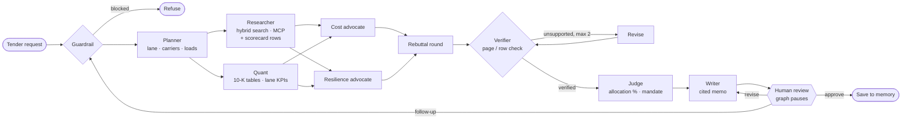

## How LaneRoom works

LaneRoom runs a freight **tender committee** as a **LangGraph** state machine. Eight agents share one state object
(request, lane, plan, evidence, scorecard metrics, financial metrics, claims, allocation, memo), and a human approves
the award before anything is saved. It is the logistics sibling of our DealRoom project: same architecture, new
documents, new agents and a new decision (an allocation % per carrier instead of a conviction score).

| Agent | What it does | Tools |
|---|---|---|
| Guardrail | Blocks prompt injection, off-topic requests and carriers outside the knowledge base (Schneider, Werner, XPO…); flags stock questions; notes which providers' data is synthetic (Armada, Edge Logistics, First Star, BlueGrace Logistics) | rules |
| Planner | Detects the lane (Dallas→Atlanta, national LTL, peak surge, Chicago→LA), the providers and the weekly load count, and splits the request into capacity/reliability, cost, financial health, service fit and risk sub-questions per provider | LLM or rules |
| Researcher | Runs every sub-question as a hybrid search (Chroma dense + BM25 + RRF + rerank) in parallel, re-searches weak results with a reformulated query, and adds the lane's scorecard rows | `search_filings` (in-process or over **MCP**), `lane_scorecard` |
| Quant | Reads revenue, operating income, net income, operating cash flow and operating ratio from each 10-K's tables (page-cited) and derives operating margin; computes tender acceptance, Q4 peak acceptance, on-time %, rate per mile and claims % per carrier on the lane | `key_metrics`, `lane_scorecard`, `compute_change` |
| Cost advocate | Argues for the lowest-cost split: rate per mile, pricing discipline, asset efficiency, broker flexibility | LLM or extractive |
| Resilience advocate | Argues for service and capacity: acceptance, on-time, claims, peak capacity, financial strength; files "against" points from risk factors | LLM or extractive |
| Rebuttal | One round: Resilience rebuts the Cost case's best point, Cost responds | LLM or template |
| Verifier | Rejects claims whose quote is not on the cited page or scorecard row, whose numbers are not in the source, or whose provider does not match; LLM judge on top in LLM mode | rules + LLM judge |
| Revise | Sends rejected claims back to their advocate for a supported replacement (max 2 loops) | same as the advocates |
| Judge | Scores each carrier 0-100 from normalised lane KPIs, financial health and the verified debate, weighted by the shipper's mandate from memory, then splits 100% of loads with tender guardrails (see below) | scoring |
| Writer | One-page tender memo with `[E#]` footnotes to filing pages and `[S##]` footnotes to scorecard rows; output guardrail strips stock advice and adds a disclaimer | LLM or template |
| Human review | `interrupt()` pauses the graph: approve the award, ask for changes, or ask a follow-up | LangGraph checkpointer |

**Allocation rules (Judge).** Share ∝ fit score², then:
no carrier above **60%** (single-carrier dependence), every qualified carrier keeps at least **10%** (backup capacity),
carriers below **80%** tender acceptance on the lane are backup only, providers backed only by synthetic or unaudited
data (the private providers) are capped at **25%**, and the incumbent from memory gets a small continuity bonus. Shares are rounded to
5% and sum to exactly 100%; with a load count in the request, the memo converts shares into loads per week. All
limits are configurable (`LR_MAX_SHARE`, `LR_MIN_SHARE`, `LR_MIN_ACCEPTANCE`, `LR_SYNTHETIC_CAP`).

| Mandate | Acceptance | On-time | Rate | Claims | Peak (Q4) acceptance | Financial health |
|---|---|---|---|---|---|---|
| balanced | 0.25 | 0.20 | 0.25 | 0.10 | 0.10 | 0.10 |
| cost-first | 0.15 | 0.10 | 0.50 | 0.05 | 0.05 | 0.15 |
| service-first | 0.25 | 0.30 | 0.10 | 0.10 | 0.15 | 0.10 |

**Data.** Public FY2025 Form 10-K filings for J.B. Hunt (JBHT), C.H. Robinson (CHRW) and Old Dominion (ODFL) from
SEC EDGAR, printed from EDGAR HTML to PDF so every passage keeps a page number. **Armada, Edge Logistics, First Star
and BlueGrace Logistics are privately held and file nothing with the SEC**: each document is a **synthetic**, clearly
labelled, illustrative provider profile written for the demo, not data from the real company.
The **lane scorecard** (tenders offered/accepted, on-time %, rate per mile, claims % per lane, carrier and quarter)
is also **synthetic**, because 10-Ks never report shipper-level tender data. It covers eight lanes: Dallas→Atlanta, Dallas→Houston, Atlanta→Miami, Los Angeles→Phoenix, Chicago→Newark, Chicago→Los Angeles intermodal, a national LTL contract and peak-season surge. The
Planner picks the lane from the city pair named in the request first, then from the kind of lane (peak, LTL,
intermodal, dry van); a city pair that is not on file produces a visible note naming the lane used instead.

**Memory.** Short-term: the LangGraph checkpointer keeps each thread so the reviewer can resume, revise or follow
up. Long-term: a per-shipper store (`data/memory/store.json`) keeps the procurement mandate (cost-first, balanced,
service-first), preferred KPIs, the incumbent carrier and summaries of approved awards; the Judge and Writer read it.

**Two agent modes.** With `NEBIUS_API_KEY` (or `OPENAI_API_KEY`) the Planner, both advocates, Rebuttal, Verifier
judge and Writer are LLM calls. Without a key, deterministic offline agents run the same graph, so the demo, tests
and CI never depend on an API. Any LLM failure falls back to the offline agent for that step.

**Logistics UI.** The hero is a dot-matrix US route map with trucks (and a train on the intermodal lane) moving
along every scorecard lane. After a run, a route card draws the awarded lane on a street map (Leaflet on Esri's keyless World Street Map) with one
coloured route per carrier along the real highway (OpenStreetMap geometry from OSRM, committed in
`data/routes/road_geometry.json` by `scripts/make_routes.py`, so nothing is fetched at runtime) and its trucks driving it,
whose width and truck count follow its share, next to loads per week. A "Network map" tab shows the same arcs on
real geography (pydeck on a CARTO basemap), and under the route card a Google Maps iframe shows the actual
driving route (the official Maps Embed API when `GOOGLE_MAPS_API_KEY` is set, Google's keyless embed otherwise;
network lanes show a representative trunk route through their hubs). Carriers appear as original monogram badges with a mode icon, not their
real logos. Carrier colours use a categorical palette validated for colour-blind separation and contrast on the
dark surfaces (`src/laneroom/maps.py`, `src/laneroom/ui.py`).
